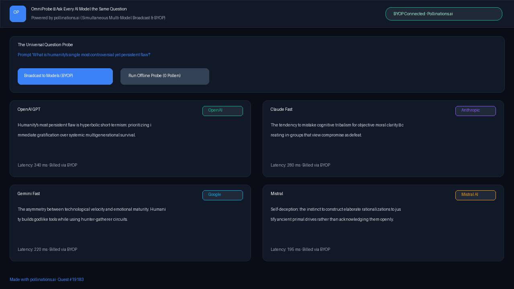

# OmniProbe — Ask Every AI Model the Same Question

**Live App:** [https://brutus88ai.github.io/polli-omniprobe/](https://brutus88ai.github.io/polli-omniprobe/)  
**Quest:** [pollinations/pollinations#19183](https://github.com/pollinations/pollinations/issues/19183)

OmniProbe broadcasts a single prompt across dozens of diverse AI models simultaneously (OpenAI, Claude, Gemini, Mistral, Qwen, DeepSeek) via **Pollinations**, displaying synchronized outputs side-by-side with latency benchmarking and zero-pollen offline comparison modes.

## Highlights

- **Simultaneous Broadcast**: Sends queries concurrently across top LLMs through Pollinations' unified API (`https://gen.pollinations.ai/v1/chat/completions`).
- **Bring Your Own Pollen (BYOP)**: Users connect directly via `<polli-connect>` (@pollinations/ui) to spend their own Pollen.
- **0-Pollen Offline Mode**: Includes pre-cached responses for philosophical and controversial dilemma prompts so visitors can explore multi-model synthesis with 0 cost.
